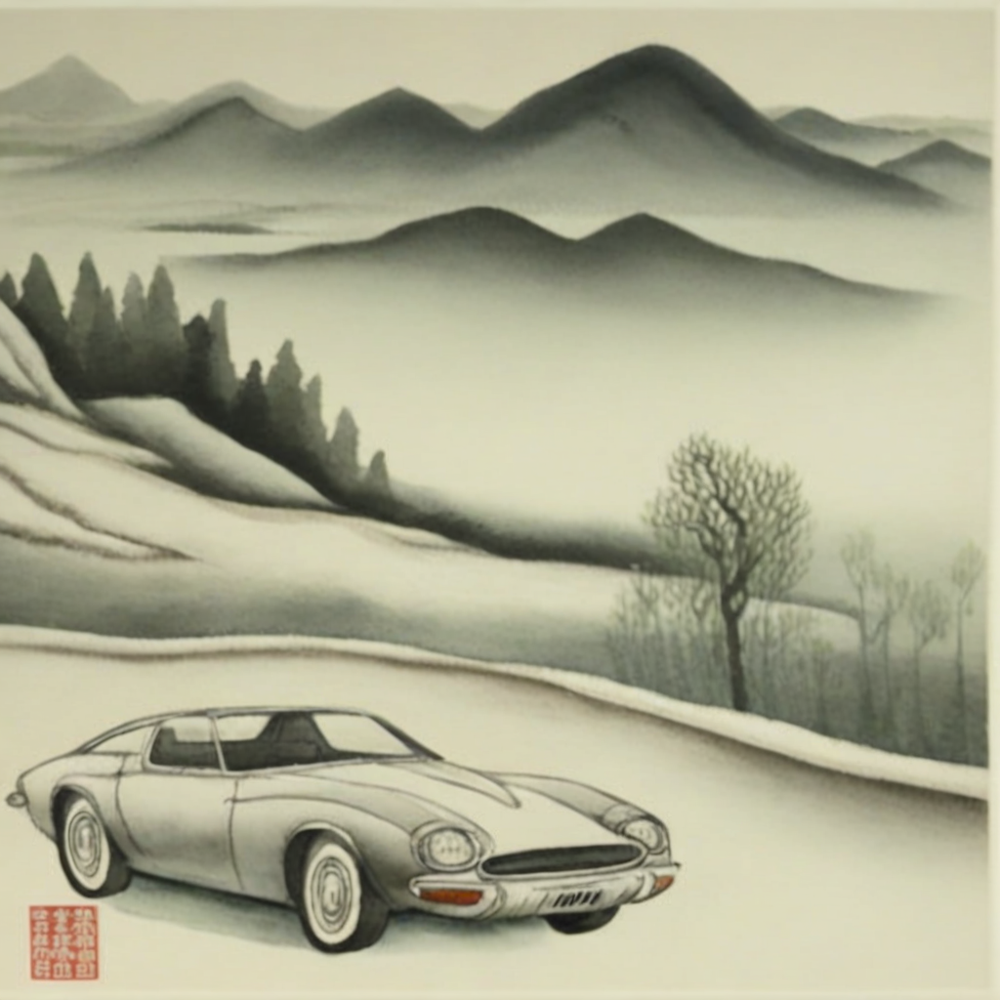
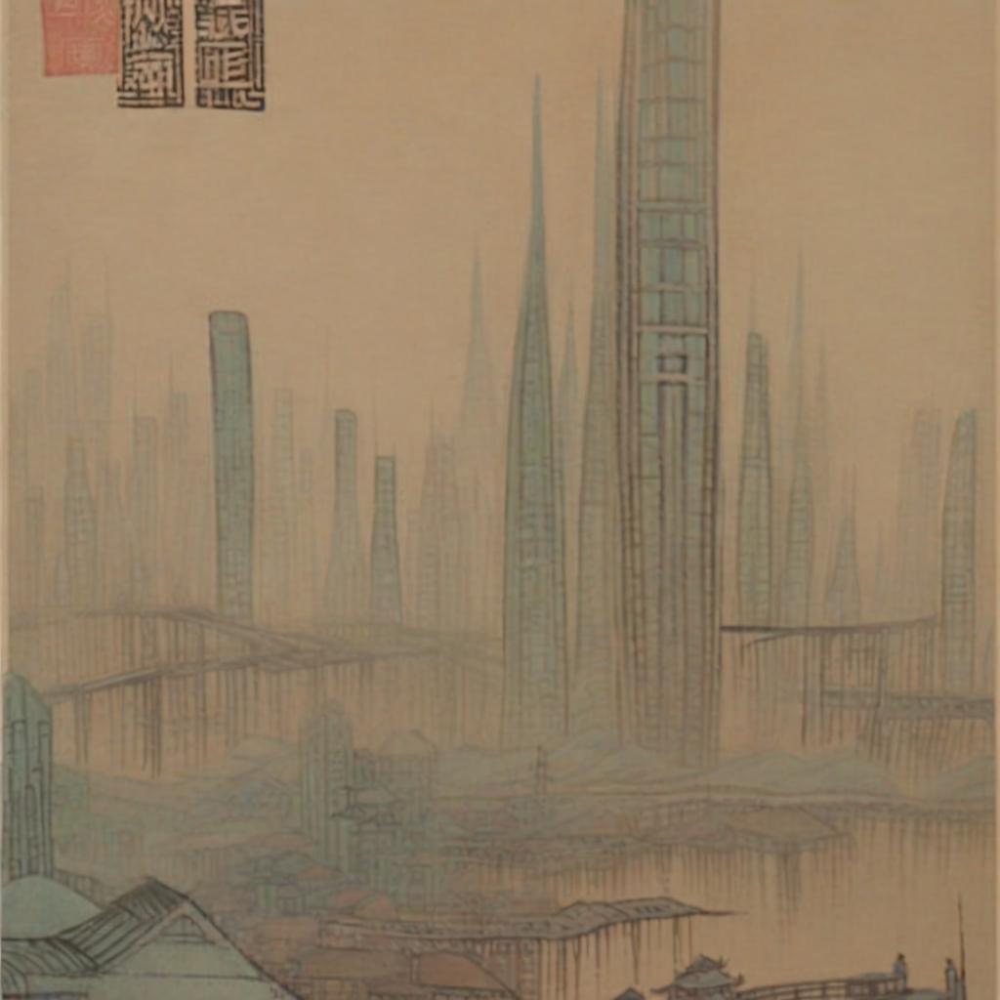
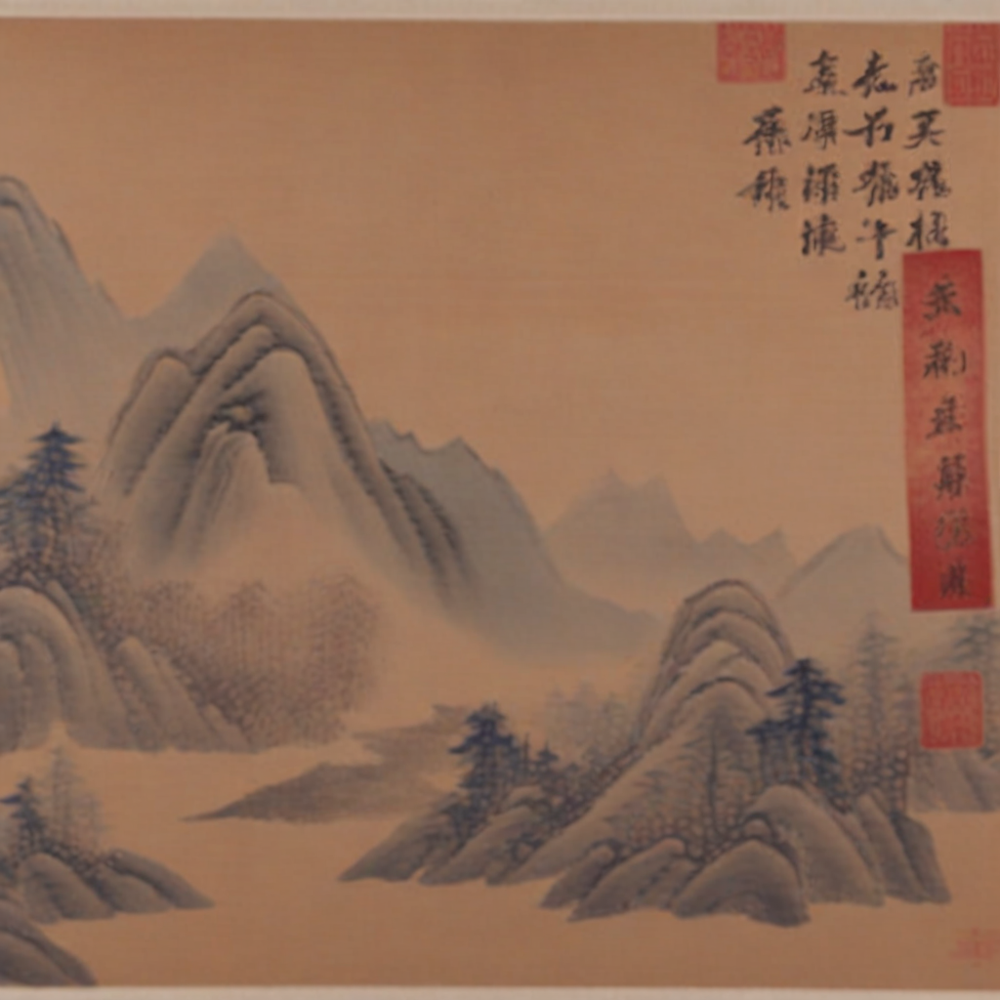
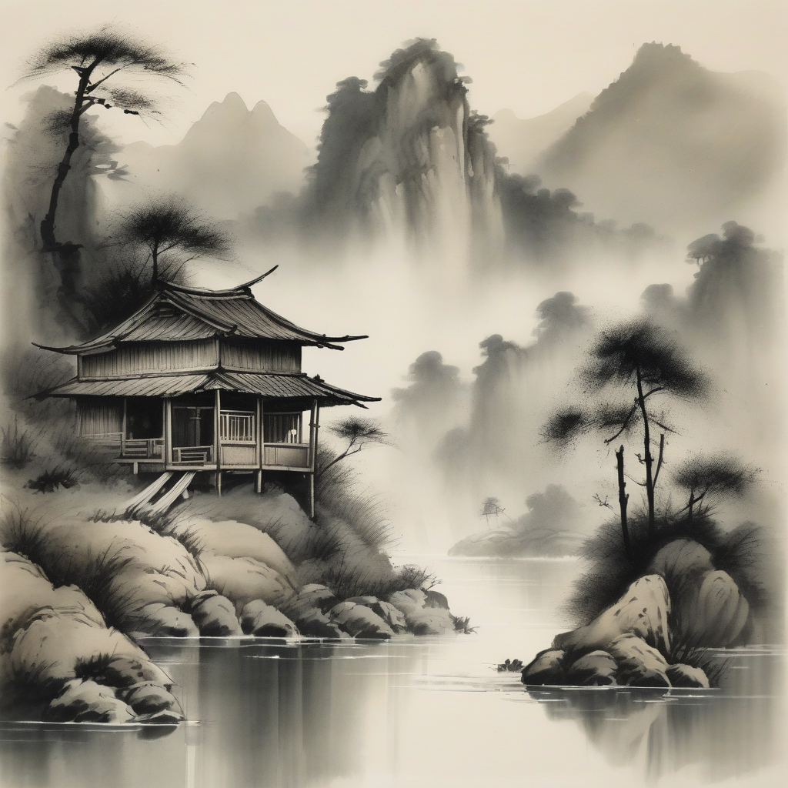
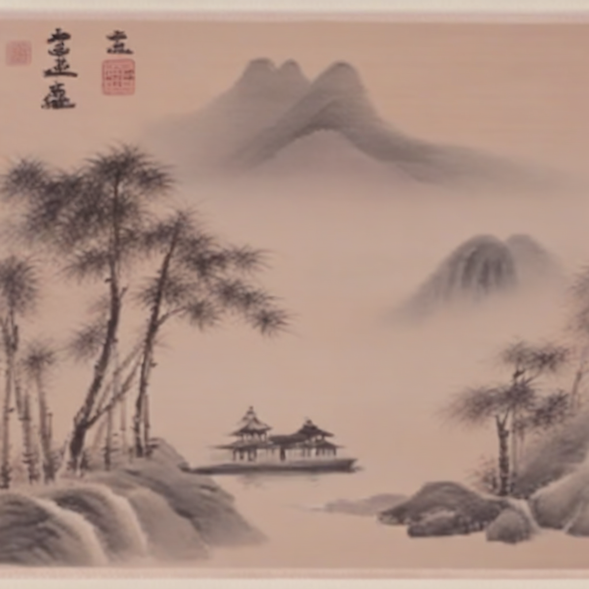
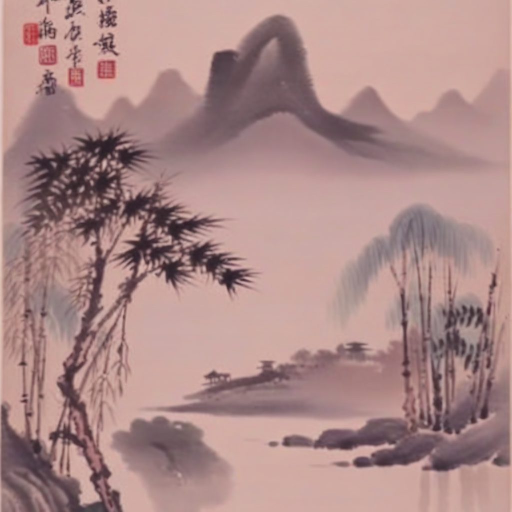
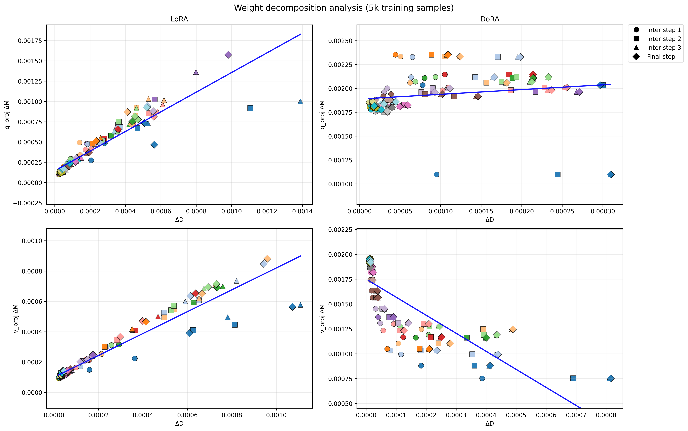

# DoRA Forge

### Efficient Adaptation for Generative AI

**New visual styles. Less than 0.5% trainable U-Net parameters.**

A hands-on generative AI project that connects **custom PyTorch adapters**, **SDXL style transfer**, **7B–13B language models**, and **DPO preference alignment**. From the math inside a layer to images you can see and benchmarks you can inspect.

<table>
  <tr>
    <td></td>
    <td></td>
    <td></td>
  </tr>
  <tr><td align="center">Ink-wash × sports car</td><td align="center">Ink-wash × future city</td><td align="center">Ink-wash × landscape</td></tr>
</table>

*Original SDXL + DoRA outputs. Explore the [full image gallery](GALLERY.md), including Base / LoRA / DoRA / target-layer FT comparisons.*

**Python · PyTorch · Hugging Face · PEFT · SDXL · LLaMA · DPO · CUDA**

[See the gallery](GALLERY.md) · [Explore the implementation](TECHNICAL.md#code-tour) · [View the poster](reports/poster.pdf)

## At a glance

| 0.48% trainable | 560 projections | 7B–13B models | 8 reasoning tasks |
| :--- | :--- | :--- | :--- |
| SDXL U-Net with DoRA | Attention layers adapted | Four LLaMA-family checkpoints | Two evaluation approaches |

## Turn a visual style into a model capability

The visual challenge: adapt SDXL to Chinese ink-wash painting, then carry that style into subjects far beyond traditional scenery. The pipeline connects training-image preparation, latent denoising, adapter optimization, and prompt-based generation—with **12.28M trainable parameters** in a roughly **2.58B-parameter adapted U-Net**.

Below are original outputs for the same riverside-landscape prompt from the large-set run:

| Base SDXL | LoRA | DoRA |
| :---: | :---: | :---: |
|  |  |  |

The gallery extends the comparison to mountains, futuristic architecture, sports cars, sketches, and character adaptation. **[Browse all visual experiments →](GALLERY.md)**

## Three tracks, one engineering foundation

| Track | What we engineered | Go to the code |
| --- | --- | --- |
| **Visual generation** | SDXL attention adapters, latent-noise training, style-transfer experiments, and four-way visual comparisons | [Diffusion pipeline](notebooks/diffusion/inkwash-large.ipynb) |
| **Language reasoning** | Custom adapters for four LLaMA-family checkpoints, rank sweeps, conditional-NLL and generation-based evaluation | [LLM pipeline](notebooks/language/commonsense.ipynb) |
| **Preference alignment** | Manual DPO loss and training loop, cached reference scores, response masking, and implicit-reward evaluation | [DPO pipeline](notebooks/alignment/manual-dpo.ipynb) |

### The depth behind the demo

- **Model internals:** `DoRALinear` learns magnitude and low-rank direction separately; automatic injection targets attention/MLP projections and supports merged-weight inference.
- **Practical GPU training:** frozen backbones, mixed precision, gradient accumulation, and checkpointing keep adaptation within usable compute budgets.
- **Implementation checks:** initialization equivalence, gradient isolation, label masking, and merge-equivalence checks test the pieces before larger runs.
- **Behavior analysis:** intermediate checkpoints and layer-wise magnitude/direction trajectories connect adapter design to how weights change.

The project also includes a **T5-based vision-language implementation** and object-feature preprocessing utilities. [Follow the code tour →](TECHNICAL.md#code-tour)

## Results worth a closer look

| Track | Highlight | Explore |
| --- | --- | --- |
| SDXL efficiency | **0.476% trainable U-Net parameters**; **77.8× fewer trainable parameters** than the target-attention-layer FT comparator | [Parameter counts](results/inkwash-large/metrics/trainable_params_summary.csv) |
| LLaMA-3-8B reasoning | **81.7%** average accuracy for DoRA-r32 vs **79.8%** for LoRA-r16: **+1.9 percentage points** in the project's NLL-scored evaluation | [Result table](results/commonsense/llama3-8b_own_methods.csv) |
| Visual style tuning | **463 training images**, **2,000 steps per trained method**, six prompts extending from traditional scenery to modern subjects | [Diffusion notebook](notebooks/diffusion/inkwash-large.ipynb) |
| Preference alignment | Manual DPO on **5,000 training / 1,000 test examples**, comparing LoRA and DoRA at ranks 16 and 32 | [DPO notebook](notebooks/alignment/manual-dpo.ipynb) |

## Look inside the learning process

<strong>Open the layer-wise weight-decomposition visualization</strong>

Query/value projection trajectories from the saved 5k-sample analysis. This is the engineering layer underneath the benchmark: inspecting how direction and magnitude change through training.

[Analysis code](src/dora_weight_decomposition_analysis.py) · [Analysis notebook](notebooks/analysis/weight-decomposition.ipynb)

## Explore in two minutes

1. **Start visual:** [Generated image gallery](GALLERY.md).
2. **Check the implementation:** [Function-by-function code tour](TECHNICAL.md#code-tour).
3. **Choose a deep dive:** [All notebooks and results](PROJECT_MAP.md) or [project report](reports/project-report.pdf).

**No GPU needed to explore.** Images, plots, and compact result tables are included. To train, use the notebook-specific CUDA/Colab setup in [Running the experiments](RUNNING.md).

## Team & foundations

Built by **Yunhe Zhang, Yunshen Song, Evelyn Feng, and Xiyu Yang** at Cornell, originally for CS 4782/5782. This showcase brings the implementation, visual experiments, and engineering takeaways into one place.

Based on [DoRA: Weight-Decomposed Low-Rank Adaptation](https://arxiv.org/abs/2402.09353) by Liu et al. Built with PyTorch and the Hugging Face ecosystem. See [acknowledgements](ACKNOWLEDGEMENTS.md) and the preserved [license](LICENSE).
